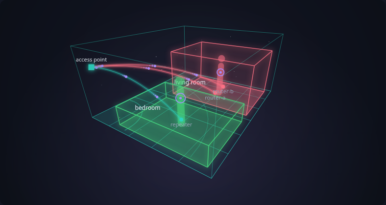
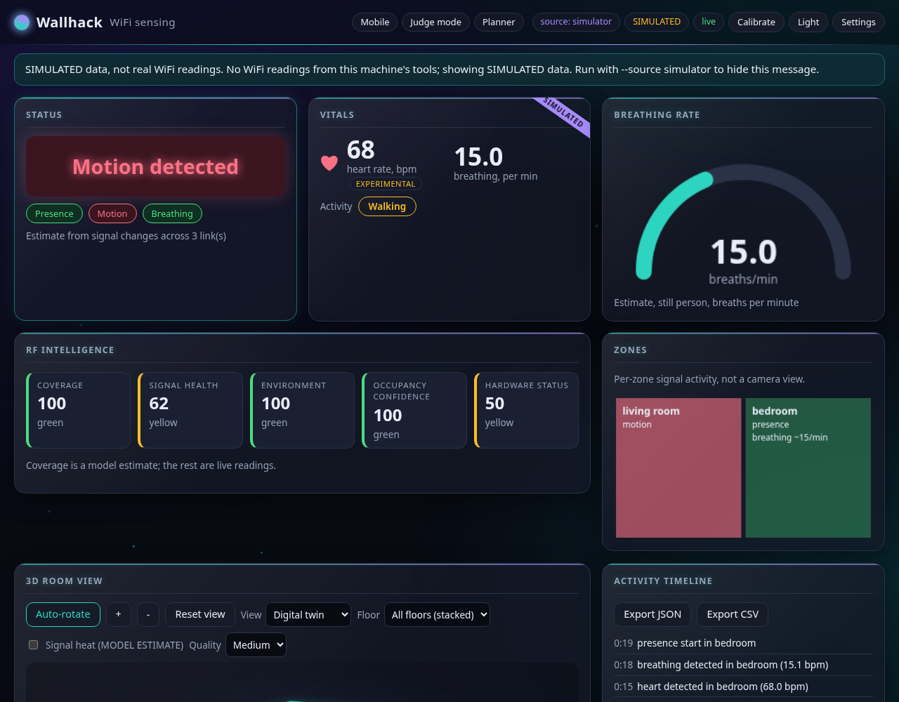
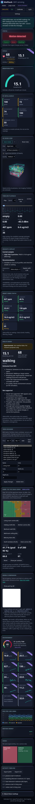
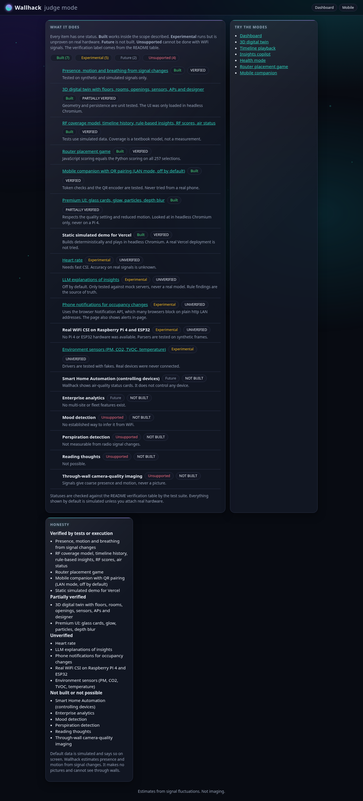
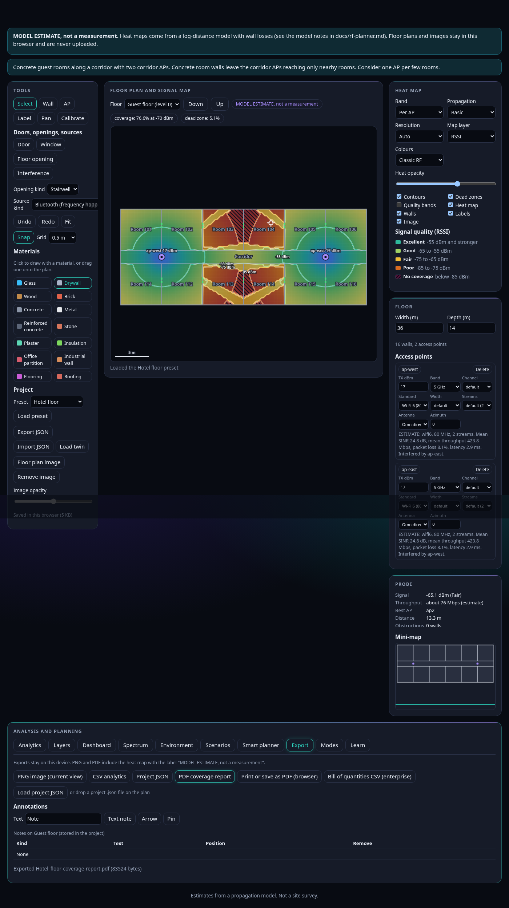
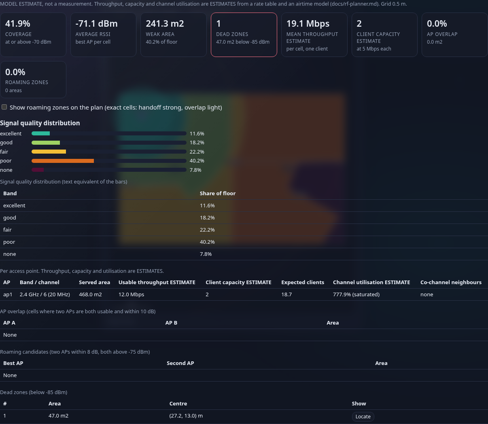
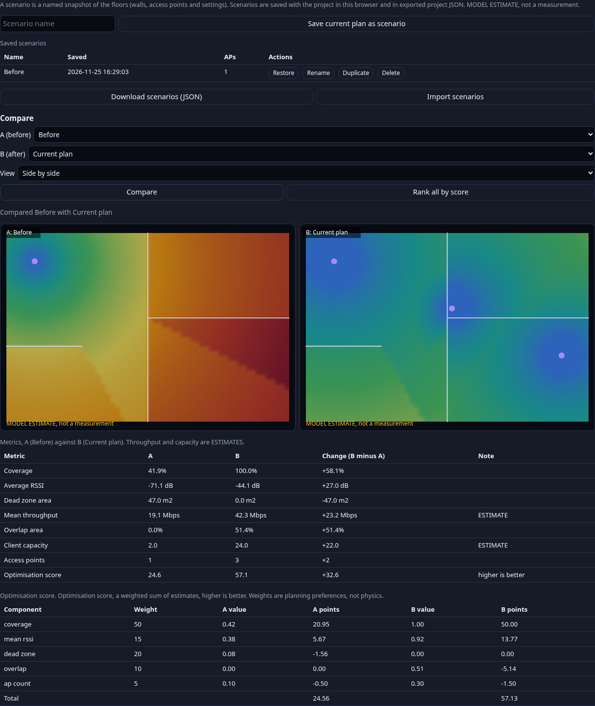
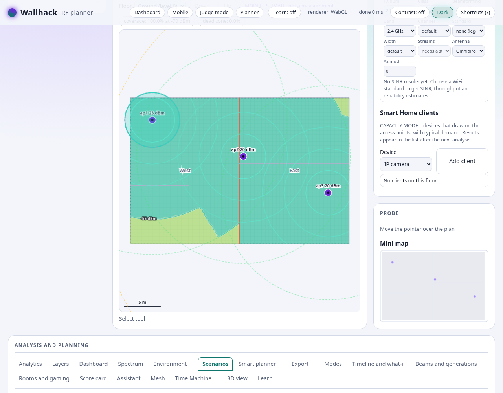
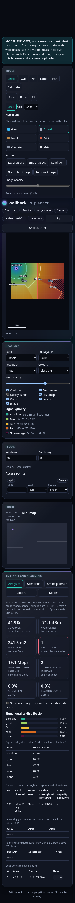
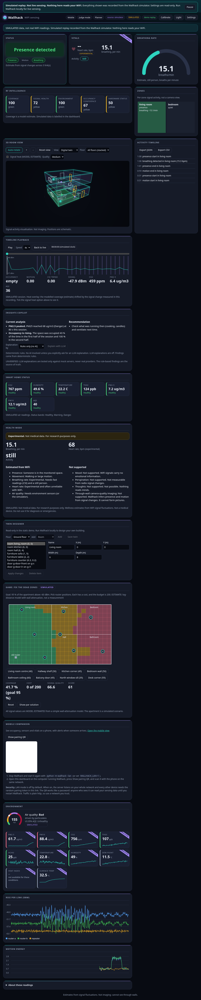

# irl-wallhack

A local WiFi sensing dashboard. It watches how your WiFi signal changes and shows **presence, motion, activity (still, walking, active), breathing rate, an experimental heart rate and a coarse zone** for the people in a room. Optional cheap sensors add **PM1/2.5/10, CO2, TVOC, formaldehyde, temperature, humidity, dew point, heat index, surface temperature and an air-quality rating with a US EPA AQI**. A **3D room view** shows signal activity per zone.



## What it is not
It does not make images and cannot literally see through walls. Bodies disturb radio signals, and that disturbance can be measured. Expect "someone is moving in the room", not a picture. Plain RSSI is coarse; richer data (ESP32 or Nexmon CSI) works better. **Breathing needs CSI-rate data** (4+ readings per second, not rounded to whole steps) and **heart rate needs 8+ readings per second** and a still person; it is experimental and low confidence. With Windows, macOS or `nmcli` signal readings (about 1 per second, coarse steps) breathing is switched off and the dashboard says so; presence and motion remain.



## Features
- **Vitals from WiFi**: breathing (0.1-0.5 Hz) and heart rate (0.8-2.0 Hz, gated at 8 Hz or more raw sampling and a strong spectral peak, peak ratio 30). Activity badge: empty, still, walking, active. The walking cadence rule is a heuristic that has only been tried on the simulator.
- **Environment tiles** (optional sensors, see below): PM, CO2, TVOC, HCHO, temperature, humidity, dew point, heat index, surface temperature, AQI ring and a worst-of air-quality rating with its drivers. Ratings are general guidance bands, not medical advice.
- **3D room view**: plain canvas, own projection maths, drag to orbit, zoom, auto-rotate, a Low/Medium/High quality selector for Raspberry Pi class devices, and reduced-motion support. It is a schematic signal-activity visualisation, not imaging.
- **Simulator**: every simulated value (vitals and environment) is marked SIMULATED. The simulated heartbeat is exaggerated so the demo shows it. With a real source and no sensors configured, environment tiles show "no sensor" and nothing is invented.



- **Mobile companion and judge mode**: `/mobile` (occupancy, vitals, sensors, alerts; pair a phone by scanning the QR on the dashboard after starting with `--lan`) and `/judge` (every capability with its Built / Experimental / Future / Unsupported status). Premium glass UI and particle effects follow the quality selector and reduced-motion setting.



- **RF planner**: `/planner` is a floor-plan editor with a model-based signal heat map (MODEL ESTIMATE, not a measurement): draw walls, place access points, import a floor-plan image and calibrate its scale, undo/redo, contours, dead zones, quality bands and hover readouts, plus an analytics dashboard, scenario comparison, a smart planner (AP placement, power and channel advice with confidence), PNG, CSV, JSON and PDF export, and mesh, capacity, IoT and enterprise planning modes. Details in `docs/rf-planner.md`, measured speed in `docs/perf-rf.md`.








Type check (dev only, needs `npx` and network once, nothing is installed into the repo): `make typecheck` runs `tsc` with `checkJs` over `rf-engine.js`, `rf-optimizer.js` and `planner-state.js`. The app itself has no build step and no Node dependency.

## Not built, on purpose
- **Smart Home Automation and enterprise analytics**: Future. Only read-only air-quality status cards exist; nothing controls a device.
- **Mood / emotion**: there is no established way to infer it from WiFi, so nothing is shown.
- **Perspiration**: no WiFi or listed-sensor method exists.
- **Through-wall "sights" / body images**: not possible with this hardware and software; the 3D view is schematic.
- **Thermal camera image** (MLX90640, AMG8833): would need an image driver; only mentioned as future hardware in [docs/hardware.md](docs/hardware.md).

## Quick start
Needs Python 3.9+. No WiFi hardware required: without a usable source it runs a labelled simulator.

```
make install      # Windows: install.bat
make run          # Windows: run.bat  (opens the dashboard at 127.0.0.1:8000)
```
Options: `python -m wallhack --source simulator|real|auto --no-browser`. Hardware notes: [docs/hardware.md](docs/hardware.md).

## Environment sensors (optional)
Supported parts: PMS5003 (PM, UART), SCD40/41 (CO2, temperature, humidity, I2C), ENS160 (TVOC, I2C), ZE08-CH2O (formaldehyde, UART), MLX90614 (surface temperature, I2C). Wiring and warm-up notes are in [docs/hardware.md](docs/hardware.md). All of it is UNVERIFIED on real devices.
```
./install.sh --sensors        # adds pyserial and smbus2 (never needed for the default install)
.venv/bin/python -m wallhack --sensors pms5003,scd4x,ens160,ze08,mlx90614 --pms-port /dev/serial0 --hcho-port /dev/ttyUSB0 --i2c-bus 1
```
Same settings as environment variables: `WALLHACK_SENSORS`, `WALLHACK_SERIAL_PMS`, `WALLHACK_SERIAL_HCHO`, `WALLHACK_I2C_BUS`. Pick any subset in `--sensors`. A sensor that fails to open shows as an error chip in the dashboard instead of being hidden.

## Raspberry Pi 4 real CSI
Real (not simulated) CSI on a Pi 4 Model B uses the nexmon_csi firmware patch. UNVERIFIED on hardware; see [docs/hardware.md](docs/hardware.md) for the full guide, buy list and what it can and cannot see.
```
./install.sh --pi-csi && scripts/pi_setup.sh install      # asks before replacing WiFi firmware
scripts/pi_setup.sh start                                  # pick your router's channel
.venv/bin/python -m wallhack --source real --csi-source nexmon --interface wlan0
```
Run the script as your normal user; it asks for sudo where needed. `install` runs `apt full-upgrade` as upstream does. Undo with `scripts/pi_setup.sh restore` (see docs/hardware.md for what it does not undo). Add `--dry-run` to any command to only print what it would do.

## Hosted demo (Vercel or any static host)
`python3 tools/build_demo.py` writes a static, simulated replay to `dist/` (needs numpy only). The recording is produced by the real Python pipeline (simulator and signal processing), one frame per WebSocket tick, and is deterministic. The page says it is a simulated replay: there is no WebSocket, it cannot read your WiFi and it is not live sensing. Heart rate in the demo is experimental and may show `--`. Preview locally with `python3 -m http.server -d dist`.

### Deploy to Vercel
No Vercel account details are stored in the repo. Either way, Vercel reads `vercel.json`, which runs `pip install numpy && python3 tools/build_demo.py` and serves `dist/`.

**Dashboard import**
1. Push this repo to your GitHub account.
2. In Vercel choose Add New, Project, and import the repo.
3. Set Framework Preset to Other. Leave build and output settings alone (they come from `vercel.json`).
4. Click Deploy.

**CLI**
```
npx vercel          # preview deployment
npx vercel --prod   # production deployment
```
A real Vercel deployment has not been tried from this repo (UNVERIFIED, see the table).



## Digital twin, insights and mobile pairing (backend)
New endpoints, all local and simulated unless real sensors are attached:

| Endpoint | What it serves |
|---|---|
| `GET/PUT /api/twin` | Building model (floors, rooms, walls, doors/windows, furniture, sensors, APs). Saved to `data/twin.json` (gitignored). The default is a sample house. |
| `GET /api/rf/coverage?floor=&cell_m=` | Coverage grid from a log-distance path-loss model with wall attenuation. A model ESTIMATE, not a measurement. |
| `GET /api/history?from=&to=&step=` | Downsampled SQLite history (`data/history.db`): occupancy, motion, vitals, signal, CSI trend, air. `history_max_rows` bounds it. |
| `GET /api/insights` | Deterministic rules: signal drop, occupancy trend, air thresholds and peaks, wall attenuation, AP relocation advice. |
| `POST /api/insights/explain` | Optional LLM rewording of those findings. Off by default (`llm_provider`: `ollama`, `llamacpp`, `openai`, `azure`). Keys only from env vars (`OPENAI_API_KEY`, `AZURE_OPENAI_API_KEY`, `AZURE_OPENAI_ENDPOINT`, `AZURE_OPENAI_DEPLOYMENT`). Cloud providers send finding text off-device and need `confirm_off_device: true` per request. |
| `GET /api/scores` | Coverage, Signal Health, Environment, Occupancy Confidence, Hardware Status with colour band and trend. |
| `GET /api/environment` | Now also `status`: Healthy, Warning or Danger per CO2, humidity, temperature, TVOC, PM2.5, PM10, AQI. |
| `GET /api/health` | Wellness readings plus explicit lists of what is not supported (mood, perspiration, thoughts, through-wall imaging). |
| `GET /api/game/scenario` | Apartment placement game with precomputed per-candidate RSSI grids; scoring lives in `wallhack/game.py`. |
| `GET /api/pair` | LAN mode only, from the host machine only: the pairing URL for a phone and its QR code as module rows. |
| `GET /api/judge` | Judge page items with status and verification label (kept consistent with the table below by a test). |

**LAN mode for the mobile companion** is opt-in: `--lan` or `WALLHACK_LAN=1`. It binds `0.0.0.0`, and every non-loopback request (HTTP and WebSocket) needs a random pairing token, sent as the `wallhack_pair` HttpOnly cookie (set by opening the pairing URL) or as `Authorization: Bearer`. The token is generated at start and kept in memory. In LAN mode requests from the host machine are trusted only when the Host header is `localhost`, `127.0.0.1`, `::1`, the LAN address or the configured host (blocks DNS rebinding). Cloud LLM use needs the `confirm_off_device` flag in the request, which is a consent prompt for the owner and is not enforced against a paired phone. Without `--lan` nothing changes: the server binds `127.0.0.1` and keeps the Host/Origin checks.

## How to run each mode
All modes start from `make run` (or `python -m wallhack`) and open `http://127.0.0.1:8000`. Add `--source simulator` to avoid needing hardware.

| Mode | How |
|---|---|
| Live dashboard and 3D view | `python -m wallhack --source simulator`. Quality selector (Low, Medium, High) is in the 3D card; Low turns off blur, bloom and particles, and `prefers-reduced-motion` freezes the effects. |
| Digital twin designer | Dashboard, Twin card, Edit. Add rooms, furniture, doors, windows, sensors and access points, then Save (`PUT /api/twin`, stored in `data/twin.json`). Read-only in the hosted demo. |
| Timeline playback | Dashboard, Timeline card. Drag the slider to replay `/api/history`; the PLAYBACK badge shows while you are off live. The demo uses a simulated 08:00 clock. |
| AI insights | Dashboard, Insights card. Rule findings always work. The "Explain with LLM" button needs a provider (next section). |
| Placement game | Dashboard, Game card: place access points in the apartment to reach the coverage goal within budget. |
| Mobile companion | `/mobile` on the same machine. For a phone: `python -m wallhack --lan` (or `WALLHACK_LAN=1`), then scan the QR in the dashboard pairing card with a phone on the same Wi-Fi. Opt-in only; default stays `127.0.0.1`. |
| Judge page | `/judge` lists every capability with Built, Experimental, Future or Unsupported and its verification label. |
| Hosted demo | `python tools/build_demo.py`, then `python3 -m http.server -d dist`. Pages: `/`, `/mobile.html`, `/judge.html`. |

## LLM provider configuration
Off by default (`llm_provider` empty). Set it with `--config`/`config.json` or `WALLHACK_LLM_PROVIDER`; related settings are `WALLHACK_LLM_MODEL`, `WALLHACK_LLM_ENDPOINT` and `WALLHACK_LLM_TIMEOUT_S`. The LLM only rewords rule findings. API keys are read from environment variables only and never sent to the browser.

| Provider | Endpoint (default) | Model | Environment variables |
|---|---|---|---|
| `ollama` | `http://localhost:11434` + `/api/chat` | `llama3.2` | none |
| `llamacpp` | `http://localhost:8080` + `/v1/chat/completions` | `default` | none |
| `openai` | `https://api.openai.com` + `/v1/chat/completions` | `gpt-4o-mini` | `OPENAI_API_KEY` |
| `azure` | `$AZURE_OPENAI_ENDPOINT` + `/openai/deployments/<deployment>/chat/completions?api-version=2024-02-01` | deployment name | `AZURE_OPENAI_API_KEY`, `AZURE_OPENAI_ENDPOINT`, `AZURE_OPENAI_DEPLOYMENT` |

`llm_endpoint` / `llm_model` override the defaults (for Azure they replace the endpoint and deployment variables). OpenAI and Azure send finding text to a cloud service, so each request must confirm it (`confirm_off_device`); the UI shows a disclosure. All four providers are UNVERIFIED against real services (mock servers only).

## Status of the ten platform items
| Item | Status | Notes |
|---|---|---|
| Digital twin (3D building, designer) | Complete | PARTIALLY VERIFIED UI (headless Chromium; designer save not clicked). |
| Timeline playback | Complete | PARTIALLY VERIFIED; playback heat is a model shifted by measured signal change. |
| AI insights | Partial | Deterministic rules complete and VERIFIED. LLM rewording UNVERIFIED against real providers. |
| Smart home | Partial | Read-only Healthy/Warning/Danger cards. Device control and enterprise analytics are deferred (Future). |
| Health mode | Partial | Breathing and experimental heart rate only. Mood, perspiration, thoughts and through-wall imaging are not supported. |
| Placement game | Complete | JS scoring matches Python on all 257 selections. |
| Mobile companion | Partial | Works in headless Chromium; real phone, notifications UNVERIFIED. |
| Premium UI | Complete | PARTIALLY VERIFIED; no Pi 4 frame-rate measurement. |
| RF intelligence scores | Complete | Model constants are textbook values, UNVERIFIED against real buildings. |
| Judge mode | Complete | Statuses are checked against this README by a test. |

## Privacy and consent
Use it only in your own space, and only on people who know about it. The dashboard listens on localhost only and rejects requests whose Host or WebSocket Origin is not local, so other web pages in your browser cannot read it. Do not expose it to a network. If you open the UDP receiver to your LAN for an ESP32, set `--udp-token` so spoofed packets are ignored. The tool never uploads anything unless you enable an OpenAI or Azure LLM provider, which sends finding text (not raw signals) to that cloud service after a per-request confirmation. `--lan` exposes the dashboard to your network behind a pairing token; use it only on a network you trust. Sensing people without their knowledge may be illegal where you live.

## Verification status
| Area | Status |
|---|---|
| Signal processing on **simulated** data (presence, motion, breathing) | VERIFIED (automated tests, simulator only) |
| Signal processing accuracy on **real** RSSI or CSI | UNVERIFIED (no recorded real traces; thresholds were tuned on the simulator) |
| Breathing gating for slow or quantised data | VERIFIED (unit tests) |
| Host/Origin checks, JSON-only settings, explicit `real` failure, stale-data note | VERIFIED (automated tests) |
| WebSocket `/ws` on a real uvicorn process | VERIFIED (smoke test) |
| Simulator determinism (same seed, same output) | VERIFIED |
| Platform output parsers (on fixture text) | VERIFIED |
| REST API and static files served | VERIFIED |
| Server smoke test (real process) | VERIFIED |
| `install.sh` in the Linux sandbox | VERIFIED |
| `run.sh` (syntax checked; same command as smoke test) | PARTIALLY VERIFIED |
| Dashboard files and JS syntax | VERIFIED (automated tests) |
| Dashboard in headless Chromium (simulator mode: loads, live WebSocket, no JS errors, `docs/screenshot.png`, via `tools/screenshot.py`) | VERIFIED (one run in this sandbox; not Firefox/Safari, not a phone) |
| `POST /api/calibrate` and cross-origin refusal | VERIFIED (automated tests) |
| Dashboard theme toggle, export, beep, offline banner | PARTIALLY VERIFIED (JS syntax check; headless Chromium load showed no JS errors and rendered the light theme; toggle, export, beep and offline banner were not clicked or exercised) |
| Heart rate, breathing and activity classifier on **synthetic** signals (gating for low rate, quantised data and motion) | VERIFIED (unit tests, synthetic only) |
| Heart rate and walking-cadence accuracy on **real** CSI (peak ratio 30 chosen against white noise and the simulator) | UNVERIFIED |
| US EPA AQI, dew point, heat index, rating bands (unit tests at breakpoints) | VERIFIED |
| Sensor frame parsers (PMS5003, SCD4x, ENS160, MLX90614) on hand-built frames from datasheet layouts | PARTIALLY VERIFIED (never fed by a real device) |
| ZE08-CH2O frame layout (`FF 17 04 dec CH CL RH RL SUM`) | PARTIALLY VERIFIED (matches two third-party transcriptions of the Winsen manual; the PDF itself could not be fetched, no module) |
| Sensor drivers and `EnvironmentHub` with fake transports (stale, error, merge) | VERIFIED (fakes only) |
| Sensor drivers on real hardware (UART, I2C, wiring, warm-up, calibration) | UNVERIFIED |
| `/api/environment`, `/api/vitals`, simulated flag, real source without sensors gives `null` | VERIFIED (automated tests) |
| 3D view projection helpers (`static/view3d.js`, run under node) | VERIFIED |
| 3D view and environment tiles in headless Chromium (simulator data: no JS errors, SIMULATED ribbons, non-blank canvas, three screenshots) | VERIFIED (one run in this sandbox, simulated data only; touch orbit on phones not tried) |
| 3D upgrade (quality levels, reduced motion, seeded dust helpers) under node tests | VERIFIED (automated tests) |
| Static demo build (`tools/build_demo.py`, deterministic output, tests) and playback in headless Chromium via `python3 -m http.server` (`docs/screenshot-demo.png`, no JS errors) | VERIFIED (one run in this sandbox, Chromium only) |
| Game scoring in JS (`static/game.js`) equals Python `game.score_selection` on all 257 selections (node vs Python) | VERIFIED (automated parity test) |
| Twin geometry helpers, panels, designer and game UI in headless Chromium (demo build + live simulator, no JS errors, non-blank canvas) | PARTIALLY VERIFIED (screenshot run only; designer save, playback and LLM button not clicked; not a Pi 4) |
| Demo heart rate | VERIFIED in the recording (simulated, exaggerated heartbeat; visible in about 40 % of frames of the 145 s loop); real heart rate UNVERIFIED |
| Actual deployment on Vercel (`vercel.json` build, headers, CSP) | UNVERIFIED (no Vercel access from the sandbox) |
| 3D view frame rate on a Raspberry Pi 4 | UNVERIFIED (low quality and auto-downgrade exist but were never measured on a Pi) |
| Twin validation and persistence, RF model determinism and monotonicity, history retention and sessions, status bands, insight rules, scores, game scoring (pytest) | VERIFIED (automated tests, simulated data) |
| RF coverage numbers versus a real building | UNVERIFIED (textbook constants, never compared with measurements) |
| RF planner basic-mode engine maths and Python/JavaScript parity | VERIFIED (golden fixture of the legacy numbers, hand-computed cases and parity tests within 0.1 dB) |
| RF planner enhanced and multipath modes (single reflection, knife-edge diffraction `v = sqrt(4 delta / lambda)`) | PARTIALLY VERIFIED (knife-edge value checked against a hand-computed Fresnel case; reflection and diffraction totals not compared with an independent reference) |
| WiFi 4-7 PHY-rate formula, noise floor, SINR with co-channel and adjacent-channel coupling, antenna pattern, MLO capacity, AP field validation, Python/JavaScript parity (`tests/test_wifi_standards.py`) | VERIFIED (hand-computed values and parity tests; legacy output unchanged) |
| WiFi standards SINR throughput, adjacent-channel rejection table, per-MCS minimum SNR, antenna and MLO numbers against real radios | UNVERIFIED (rounded planning figures, never compared with measurements) |
| Material database (ten families, ranges, confidence, schema, generated doc `docs/platform/material-database.md`) structure and consistency | VERIFIED (schema and doc-sync tests, legacy values unchanged) |
| Material attenuation and reflection figures, including reinforced concrete, stone, flooring and roofing, against real buildings | UNVERIFIED (rounded typical values within ITU-R P.2040 style ranges, low confidence for the new entries) |
| AP panel controls for standard, width, antenna pattern and azimuth | PARTIALLY VERIFIED (JavaScript syntax check only; not clicked in a browser) |
| RF planner propagation accuracy against real buildings, throughput and capacity numbers | UNVERIFIED (planning estimates only) |
| RF planner UI (draw, undo, drag, import, calibrate, analytics, scenarios, smart planner, exports, modes), live and static demo | PARTIALLY VERIFIED (scripted run in headless Chromium on SwiftShader, `tools/planner_smoke.py`; no real GPU, no touch device) |
| RF planner on a real GPU, touch and pinch, Raspberry Pi 4 speed | UNVERIFIED |
| RF planner PDF and PNG exports opened in a real viewer | UNVERIFIED (structure and signature checked by script only) |
| LLM providers (ollama, llama.cpp, OpenAI, Azure) request and response handling | UNVERIFIED (mocked local HTTP servers only; never called a real model or cloud service) |
| LAN pairing: default stays loopback, unauthenticated remote HTTP and WebSocket refused, cookie and bearer accepted, loopback client with a foreign Host header refused (DNS rebinding), `/api/pair` refused with an Origin header | VERIFIED (automated tests with a simulated remote client; not tried from a real phone) |
| Demo exports (`history.json`, `twin.json`, `insights.json`, `scores.json`, `scenario.json`, `health.json`), numpy pinned in `vercel.json` | VERIFIED locally (deterministic build); Vercel build with the pinned numpy UNVERIFIED |
| Mood, perspiration, thoughts, through-wall imaging | NOT BUILT (no valid method; see above) |
| Smart Home Automation and enterprise analytics (Future) | NOT BUILT (only read-only air-quality status cards exist; nothing controls a device) |
| QR pairing code (`wallhack/qr.py`, versions 1-6, level M) | VERIFIED (decoded by OpenCV in tests when installed; never scanned by a phone camera) |
| Mobile companion page and phone pairing from a real phone | PARTIALLY VERIFIED (loaded in headless Chromium with simulated data; no real phone or Wi-Fi network) |
| Phone occupancy notifications (Notification API) | UNVERIFIED (not exercised in a browser; blocked on plain http LAN addresses by many browsers) |
| Premium UI effects (glass cards, glow, particles; low quality and reduced motion switch them off) | PARTIALLY VERIFIED (headless Chromium screenshots and node tests of the helpers; not a Pi 4, no frame-rate measurement) |
| Judge page statuses (`wallhack/judge.py`) match this table | VERIFIED (automated test compares each item with its row) |
| Real collectors on Raspberry Pi 4 | UNVERIFIED |
| Windows 11 (collector, `install.ps1`, `install.bat`, `run.bat`) | UNVERIFIED |
| macOS collector | UNVERIFIED |
| `netsh` parsing on non-English Windows | PARTIALLY VERIFIED (hand-written German/Spanish fixtures, no real captures) |
| `tools/csi_forwarder.py` (Nexmon frames to UDP JSON; BCM43455c0 decoded as int16 per upstream) | PARTIALLY VERIFIED (synthetic frames only, never a real capture) |
| Nexmon frame/pcap decoding and `NexmonCollector` on fixtures built from upstream docs | VERIFIED (synthetic only) |
| End-to-end synthetic CSI to breathing rate | VERIFIED (synthetic only) |
| `scripts/pi_setup.sh` dry-run and check logic with a fake model file | PARTIALLY VERIFIED (not run on a Pi) |
| nexmon build and firmware install, monitor-mode config, tcpdump capture, real CSI decoding with real frames, real breathing accuracy, systemd unit | UNVERIFIED (no Pi 4 in the sandbox) |
| ESP32 CSI over UDP: packets, token (collector and `Runtime` wiring) and timestamps over a local socket | VERIFIED |
| ESP32 / Nexmon hardware end to end | UNVERIFIED |

## Tests
The QR tests decode codes with OpenCV and are skipped without it (`pip install opencv-python-headless`; CI installs it).
```
.venv/bin/python -m pip install -r requirements-dev.txt   # pytest and httpx, test-only
.venv/bin/python -m pytest -q
```
