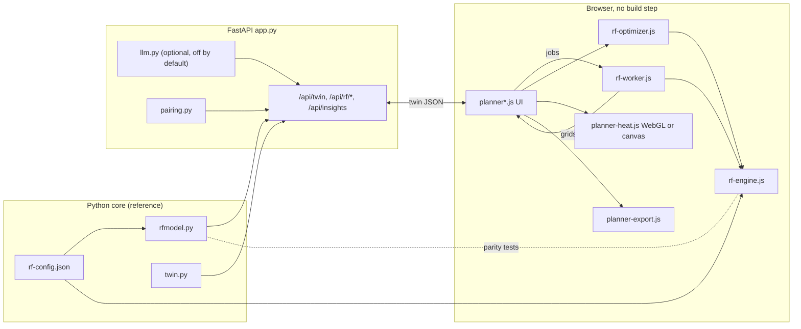
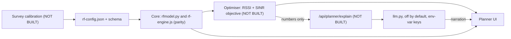

# 03 Architecture

## Current architecture (VERIFIED against the code)

Notes:

- The dotted line is the only coupling between the Python reference and the JS port: tests (`tests/test_rf_parity.py`, `tests/test_wifi_standards.py`).
- `rf-optimizer.js` runs in the worker for `plan` jobs and on the main thread for direct calls. It is deterministic.
- The LLM only receives rule findings from `insights.py` today. It never touches planner numbers (the explain route for planner advice is NOT BUILT).
- The static Vercel demo has no server: `demo.js` maps `/api/*` calls to JSON files built by `tools/build_demo.py`. The planner runs fully in the browser.

## Sensing path (separate from the planner)

`collectors/*` and `simulator.py` feed `runtime.py`, which runs `processing.py`, `insights.py`, `scores.py`, `history.py` and serves `/ws` plus REST routes to `app.js`, `panels.js`, `view3d.js`, `mobile.js`, `judge.js`.

## Target architecture (DESIGN ONLY)

Principles that stay: the engine computes every number, the LLM narrates numbers it is given, defaults stay local-only, no build step unless the ADR is revisited ([adr-frontend-stack.md](adr-frontend-stack.md)).
