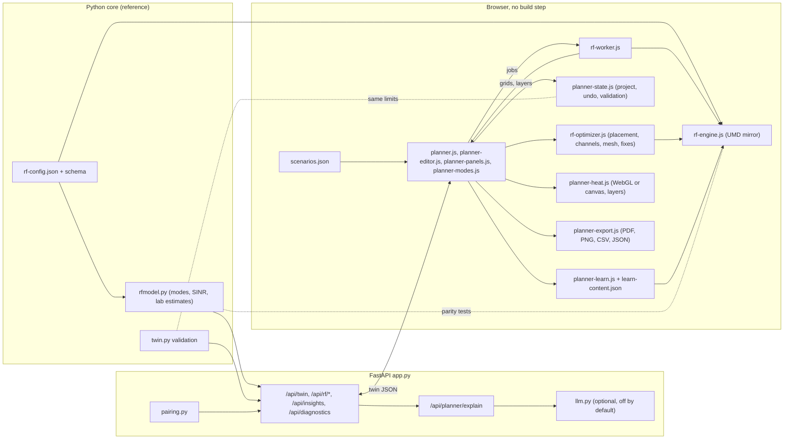
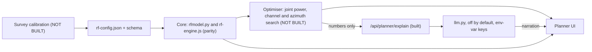

# 03 Architecture

## Current architecture (VERIFIED against the code)

Data flow for one analysis: the editor changes the project in `planner-state.js`, the UI posts a job to `rf-worker.js`, the worker calls `rf-engine.js` (coarse pass first, then tiles), and the result arrays go to `planner-heat.js` and the panels. Exports read the same results, so a PDF never recomputes a number.

Notes:

- The dotted lines are the only couplings between duplicated implementations: Python and JS propagation maths (`tests/test_rf_parity.py`, `test_wifi_standards.py`, `test_rf_lab.py`) and project limits shared through `rf-config.json` (`tests/test_planner_state.py`, `tests/test_twin.py`).
- `rf-optimizer.js` runs in the worker for `plan` jobs and on the main thread for direct calls. It is deterministic.
- The LLM never computes a number. `POST /api/planner/explain` builds its text from engine numbers, falls back to deterministic text when the LLM is off, and checks that a reply only uses numbers it was given. Cloud providers need per-request consent.
- The static Vercel demo has no server: `demo.js` maps `/api/*` calls to JSON files built by `tools/build_demo.py`. The planner runs fully in the browser.
- Extension points: a new propagation mode is registered with `register_mode` in `rfmodel.py` and mirrored in `rf-engine.js`; a new heat layer is a `planner_layers` entry plus a builder in `planner-heat.js`; a new material is a `materials` entry. See [CONTRIBUTING.md](../../CONTRIBUTING.md).

## Sensing path (separate from the planner)

`collectors/*` and `simulator.py` feed `runtime.py`, which runs `processing.py`, `insights.py`, `scores.py`, `history.py` and serves `/ws` plus REST routes to `app.js`, `panels.js`, `view3d.js`, `mobile.js`, `judge.js`.

## Target architecture (DESIGN ONLY)

Principles that stay: the engine computes every number, the LLM narrates numbers it is given, defaults stay local-only, no build step unless the ADR is revisited ([adr-frontend-stack.md](adr-frontend-stack.md)).
